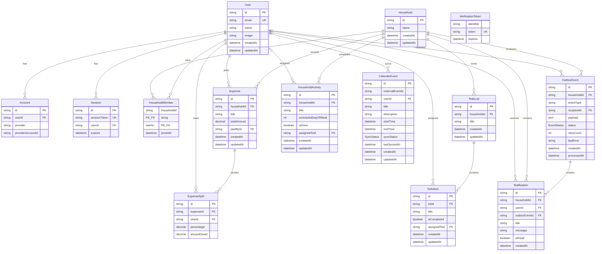

# Household Split Entity Diagram

## Enumerations

- `EventStatus`: `PENDING`, `PROCESSING`, `PROCESSED`, `FAILED`
- `SyncStatus`: `PENDING`, `SYNCED`, `FAILED`

`VerificationToken` is intentionally shown without relationships because the Prisma model has no foreign keys. Optional relationships are marked with `o|` on the user side: todo assignment, activity assignment, and outbox recipient. Foreign keys with `onDelete: Cascade` or `onDelete: SetNull` follow the behavior defined in `prisma/schema.prisma`.
